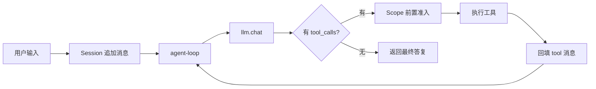

# agent-harness

[](https://github.com/hhy32744/agent-harness/actions/workflows/ci.yml)

**让大模型自己决定抓什么、什么时候停，同时把工具、域名和预算锁死。**

一个由大模型驱动、可约束的网页爬取 Agent。当前交付的是它的最小可运行内核：消息协议、工具执行、会话记录、作用域与 agent 主循环。不依赖框架、不引第三方运行时库，只用 TypeScript + Node 内置能力。

`Node ≥ 18` · `TypeScript ^5.6` · `零第三方运行时依赖` · `19 / 19 测试通过` · `ISC`

---

## 目录

- [项目目标](#项目目标)
- [快速开始](#快速开始)
- [项目结构](#项目结构)
- [系统怎么跑](#系统怎么跑)
- [内核模块](#内核模块)
- [四个设计决定](#四个设计决定)
- [现状与路线图](#现状与路线图)
- [底层抓取能力](#底层抓取能力)
- [写成自己的 Agent](#写成自己的-agent)
- [文档导航](#文档导航)
- [环境与约定](#环境与约定)

---

## 项目目标

普通爬虫把步骤写死：`抓首页 → 正则抽链接 → 抓前三个 → 存文件`。这个项目把「下一步做什么」交给模型：人只给**一句任务**、**一组工具**、**一套边界**；模型每轮看当前消息流，自己挑工具、填参数，工具结果回填后它再看、再决定，直到某一轮不再调用工具为止。

| | 步骤由谁决定 | 失败时 | 边界在哪 |
| --- | --- | --- | --- |
| 传统爬虫脚本 | 写代码的人 | 抛异常或中断 | 散落在各处判断 |
| 本项目 | 模型每一轮 | 变成一条 `isError` 消息，模型可自我修正 | `Scope` 在工具执行前统一收口 |

> [!NOTE]
> 现在**还不是成品爬虫**：`npm run demo` 用离线脚本模型 + 本地 mock 站点，验证的是这条闭环本身（包括它的全部失败路径）；`npm run demo:live` 才接真实 DeepSeek。真实站点调度、限速、去重、断点续爬还在路线图里。

| 你想… | 去这里 / 跑这条 |
| --- | --- |
| 先把项目跑起来 | 下面「快速开始」的 3 条命令 |
| 搞懂内核为什么这样设计 | [架构与设计说明](docs/architecture.md) |
| 加工具、换模型、收边界 | [架构说明 · 扩展点](docs/architecture.md#6-扩展点) |
| 弄明白底层 `fetch` 的行为 | [底层抓取能力说明](docs/fetch-baseline.md) |
| 知道该往哪放文件、怎么提交 | [开发与提交约定](docs/contributing.md) |

## 快速开始

从 GitHub 全新克隆（`npm ci` 严格按锁文件安装，不用先手动编译）：

```bash
git clone git@github.com:hhy32744/agent-harness.git
cd agent-harness
npm ci
npm test          # 19 个用例，覆盖主循环全部退出路径与真实模型适配器
npm run demo      # 离线端到端闭环：脚本模型 + 本地 mock 站点
```

本地开发时把 `npm ci` 换成 `npm install` 即可；两条命令都只需要 `typescript` 与 `@types/node` 两个开发依赖。

> [!TIP]
> `npm run demo` **不需要 API key、不发外网请求**，会把 `LLM → 工具 → LLM` 完整跑一遍，还故意请求一次白名单外的站点，用来验证边界确实生效。

> [!NOTE]
> 每次 push 都会触发 [CI](.github/workflows/ci.yml)：**Ubuntu / Windows / macOS × Node 18 / 20 / 22** 共 9 组，依次跑 `npm ci → typecheck → test → demo → demo:fetch`。上面的命令与 CI 完全一致，所以「下载下来就能跑」是被自动验证的，不是靠文档承诺。

想接真实模型：

```bash
DEEPSEEK_API_KEY=sk-xxx npm run demo:live
```

<details>
<summary><b>全部命令</b></summary>

| 命令 | 作用 |
| --- | --- |
| `npm ci` | 全新安装（严格按锁文件，首次克隆与 CI 用这个） |
| `npm install` | 本地开发时安装依赖（仅 `typescript` 与 `@types/node`） |
| `npm run build` | `tsc` 编译到 `build/` |
| `npm run typecheck` | 只做类型检查，不产出文件 |
| `npm run verify` | 类型检查 + 全量测试 |
| `npm test` | 编译 + 运行 19 个用例 |
| `npm run demo` | 离线端到端闭环 |
| `npm run demo:live` | 换成真实 DeepSeek 模型，agent 代码不变 |
| `npm run demo:fetch` | 底层 `fetch` 行为自检（本地站点，不出网） |
| `bash scripts/setup.sh` | Linux 一键装环境 + 自检 + 跑闭环 |

</details>

<details>
<summary><b>npm run demo 输出节选</b>（端口与耗时每次不同）</summary>

```
[    2ms] t1 tool.call  fetch_url {"url":"http://127.0.0.1:62132"}
[   39ms] t1 tool.done  fetch_url ok 459 chars
[   39ms] t2 tool.done  fetch_url ERROR 42 chars      ← 白名单外，未出网
[   41ms] t3 tool.done  extract_links ok 279 chars
[   45ms] t4 tool.done  fetch_url ok 369 chars
[   54ms] t5 tool.done  save_markdown ok 106 chars
[   55ms] t6 session  end     status=completed
```

结果写到 `out/crawl-report.md`，终端同时打印 `status / turns / tool calls / messages / events / elapsed` 等指标。

</details>

## 项目结构

```
agent-harness/
├─ src/                        ← 内核：唯一公共 API 来源
│  ├─ index.ts                 公共出口（上层只从这里 import）
│  ├─ types.ts                 消息协议（system / user / assistant / tool）
│  ├─ llm/                     LLMClient + DeepSeek 适配 + 离线脚本模型
│  ├─ tools/                   ToolRegistry + fetch_url / extract_links / save_markdown
│  ├─ session/                 消息流 + 事件日志 + fork
│  ├─ scope/                   工具/主机白名单、轮次与次数/超时/输出预算
│  ├─ system-prompt/           按工具集与作用域动态拼提示词
│  ├─ agent-loop/              主循环（唯一控制流）
│  └─ agent/                   装配成 runAgent
├─ examples/                   ← 可运行示例
│  ├─ cli.ts                   端到端闭环（demo / demo:live）
│  ├─ mock-site.ts             本地 mock 站点
│  └─ fetch-basics.ts          底层抓取能力自检（demo:fetch）
├─ tests/core.test.ts          ← 19 个用例
├─ scripts/setup.sh            ← Linux 一键装环境与自检
├─ docs/                       ← 架构、底层能力、开发约定
├─ .github/workflows/ci.yml    ← 多平台自动验证
├─ build/  out/                ← 编译产物与运行产物（均已忽略）
└─ package.json / tsconfig.json / package-lock.json / LICENSE / .gitignore / .gitattributes / .editorconfig
```

**分层原则**：`examples/` 与 `tests/` 单向依赖 `src/`，内核不反向依赖它们。编译产物按目录分开落在 `build/`，内核单独位于 `build/src/`，可独立引用。工作区同级的 `deliverables/` 存放报告类交付物，不纳入版本控制。

## 系统怎么跑



`Scope` 的判定发生在工具执行**之前**：被拒绝的调用一个字节都不会发出去，但也不会让进程崩溃——它会变成一条「你被拒绝了」的消息，模型下一轮照常继续干活。

## 内核模块

| 模块 | 位置 | 职责 |
| --- | --- | --- |
| 消息协议 | `src/types.ts` | 四类消息、`ToolCall`、`TokenUsage`、错误描述 |
| LLM 适配 | `src/llm/` | `LLMClient` 接口、OpenAI 兼容实现（DeepSeek）、离线 `ScriptedLLM` |
| 工具 | `src/tools/` | 注册表 + 抓取 / 抽链接 / 落盘三个内置工具 |
| 会话 | `src/session/` | 给模型看的 `messages`、给人复盘的 `events`、快照与 `fork` |
| 作用域 | `src/scope/` | 工具与主机白名单、轮次 / 次数 / 超时 / 输出长度预算 |
| 系统提示词 | `src/system-prompt/` | 按当前工具集与作用域动态拼装 |
| 主循环 | `src/agent-loop/` | **唯一控制流**：`llm.chat → tool_calls → 执行 → 回填 → 再问模型` |
| 装配 | `src/agent/` | `runAgent`：建工具表、建会话、塞提示词、调主循环 |
| 公共出口 | `src/index.ts` | 上层唯一 import 入口 |

## 四个设计决定

| 决定 | 一句话说明 |
| --- | --- |
| **错误也是消息** | 未知工具、非法 JSON、超时、被拒绝，都变成 `isError` 的 `tool` 消息回填，模型能自我修正，进程不退出 |
| **作用域前置** | `Scope` 在执行前判定；`fetch_url` 重定向后二次校验最终主机，防 302 绕过白名单 |
| **消息流 / 事件日志分离** | `messages` 严格按协议给模型看，`events` 记录轮次、耗时、拒绝原因给人复盘 |
| **超时靠 `Promise.race`** | 只传 `AbortSignal` 不够——卡死的工具不理会 abort，必须外部竞速把它变成真正的拒绝 |

完整的模块职责、失败路径清单和扩展方式见 [架构与设计说明](docs/architecture.md)。

## 现状与路线图

按**能力**推进，不按批次编号：

| 状态 | 能力 |
| --- | --- |
| ✅ 已跑通 | 消息协议、DeepSeek 与离线脚本模型、工具注册与三个内置工具、会话双记录、作用域与重定向复查、agent 主循环、全部失败路径与模型适配器的 19 项测试、离线端到端闭环、底层 `fetch` 自检、多平台 CI |
| 🔜 下一步 | 真实站点任务编排、URL 归一化与去重、限速与 `robots.txt`、批量并发抓取、结果结构化与清洗 |
| 🧩 后续 | 断点续爬、会话持久化、真实模型回归、可观测面板 |

> [!NOTE]
> 目标是**完整爬取 Agent**，内核只是底座：加能力就加 `ToolDefinition`，收边界就改 `Scope`，换模型就实现 `LLMClient`——都不用动 `agent-loop`。

## 底层抓取能力

工具脚下是 Node 内置 `fetch`，有几条容易踩的运行时事实：响应头到达 ≠ 正文读完、4xx/5xx 不会 reject、`AbortController` 是唯一取消入口、重定向后要复查主机、并发省的是 I/O 等待。

```bash
npm run demo:fetch     # 本地 mock 站点，5 个场景全部离线复现
```

完整结论与代码对应关系见 [底层抓取能力说明](docs/fetch-baseline.md)，自检脚本在 [examples/fetch-basics.ts](examples/fetch-basics.ts)。

## 写成自己的 Agent

从公共出口 import 即可：

```ts
import { runAgent, Scope, webTools, OpenAICompatibleClient } from "./src";

const { result, session } = await runAgent("抓取 example.com 首页并总结", {
  role: "网页信息抽取助手",
  llm: new OpenAICompatibleClient({ apiKey: process.env.DEEPSEEK_API_KEY! }),
  tools: webTools,
  scope: Scope.crawler(["example.com"]),
});

console.log(result.status, result.turns, result.text);
// 消息流和事件都在 session 上：session.messages / session.events
```

想续跑或分支会话，绕开 `runAgent` 直接调 `runAgentLoop`，它接受现成的 `Session`。

## 文档导航

| 文档 | 内容 |
| --- | --- |
| [README.md](README.md) | 项目目标、快速开始、结构、现状与路线图 |
| [docs/architecture.md](docs/architecture.md) | 分层、数据流、四个设计决定、失败路径、扩展点、编译布局 |
| [docs/fetch-baseline.md](docs/fetch-baseline.md) | 底层 `fetch` 的运行时事实、实测结论与内核代码对应 |
| [docs/contributing.md](docs/contributing.md) | 目录规则、commit 规范、环境变量、结构演进 |

## 环境与约定

| 项 | 值 |
| --- | --- |
| Node.js | ≥ 18（内置 fetch），实测 18.20.8 / 22.22.2 |
| TypeScript | `^5.6`（devDependency，锁文件固定 5.9.3） |
| 真实模型 | DeepSeek `deepseek-chat`，OpenAI 兼容协议，需 `DEEPSEEK_API_KEY` |
| 可选覆盖 | `DEEPSEEK_MODEL`、`DEEPSEEK_BASE_URL` |

**提交约定**：一个主题一个 commit，用 `feat:` / `fix:` / `docs:` / `chore:` / `refactor:` / `test:` 前缀写清「改了什么、为什么」；不提交 `node_modules/`、`build/`、`out/`、`.env`，API key 只从环境变量读。详见 [开发与提交约定](docs/contributing.md)。
