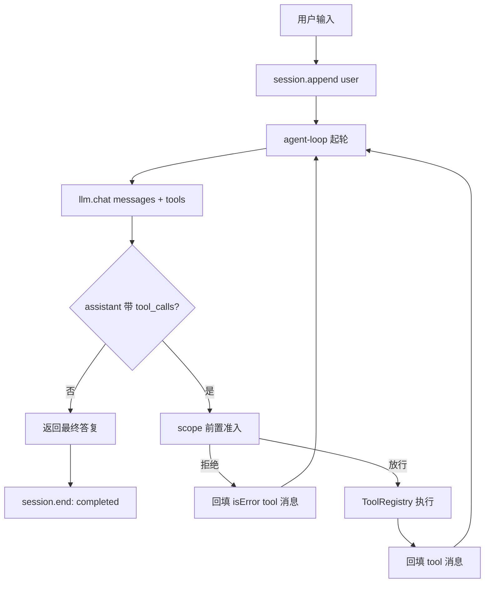

# 架构与设计说明

> 本文是 [README](../README.md) 的深入版，解释这套内核**为什么这样设计**。
> 只想把项目跑起来，直接看 README 的「快速开始」即可。

## 1. 边界与依赖方向

整个仓库只有一条依赖方向：**上层依赖内核，内核不依赖上层**。

```
examples/  ─┐
            ├──▶  src/  ──▶  Node 内置能力（fetch / node:http / node:test）
tests/     ─┘
```

- `src/` 是唯一的公共 API 来源，不 import 任何 `examples/`、`tests/` 里的东西。
- `examples/` 只负责演示「怎么用内核拼出一个 agent」，可以随意改写；其中 `fetch-basics.ts` 是纯底层的离线自检，不依赖内核。
- `tests/` 只通过 `src` 的公共出口访问内核，不碰内部文件，这样重构内核时测试不用跟着改。
- 第三方运行时依赖为 **0**：只用 TypeScript 类型 + Node 内置能力。

## 2. 模块职责

| 模块 | 位置 | 职责 |
| --- | --- | --- |
| 消息协议 | `src/types.ts` | `system / user / assistant / tool` 四类消息、`ToolCall`、`TokenUsage`、错误描述 |
| LLM 适配 | `src/llm/` | `LLMClient` 接口；OpenAI 兼容实现（DeepSeek）与离线脚本模型 `ScriptedLLM` |
| 工具 | `src/tools/` | `ToolRegistry` 注册与执行；内置 `fetch_url` / `extract_links` / `save_markdown` |
| 会话 | `src/session/` | 消息流 `messages`、事件日志 `events`、快照与 `fork` |
| 作用域 | `src/scope/` | 工具白名单、域名白名单、轮次 / 次数 / 超时 / 输出长度预算 |
| 系统提示词 | `src/system-prompt/` | 按当前工具集与作用域动态拼装提示词 |
| 主循环 | `src/agent-loop/` | **唯一控制流**：`llm.chat → tool_calls → 执行 → 回填 → 再问模型` |
| 装配 | `src/agent/` | `runAgent`：建工具表、建会话、塞提示词、调用主循环 |
| 公共出口 | `src/index.ts` | 上层唯一 import 入口 |

`agent` 这一层只有一个函数、一个 `for` 都没有。想控制会话生命周期（续跑、分支）就绕开 `runAgent`，直接调底层的 `runAgentLoop`——它本来就接受一个现成的 `Session`。

## 3. 一次 run 的数据流



注意 `scope` 判定发生在工具执行**之前**，被拒绝的调用不产生任何副作用。工具执行结果（包括错误）统一回填成 `tool` 消息，成为下一轮模型的输入。

底层 `fetch` 的运行时事实与这些设计的关系，见 [底层抓取能力说明](fetch-baseline.md)。

## 4. 四个刻意的设计决定

### 4.1 错误也是消息

未知工具、非法 JSON、超时、被 scope 拒绝、写文件越界，全部变成一条 `isError: true` 的 `tool` 消息回填给模型，而不是抛异常退出进程。

好处有两个：模型看得见失败原因，有机会自我修正；一次工具失败不会让整个 run 崩溃。`session.snapshot().stats.toolErrors` 会统计这类错误，给人复盘用。

### 4.2 作用域前置 + 重定向二次校验

`Scope` 在工具执行前判定工具名与主机白名单。`fetch_url` 还会在跟随重定向后再次校验**最终主机**，避免用 302 绕过白名单。工具本身也做防御：`save_markdown` 用 `resolve` 把目标路径限制在 `out/` 内，防目录穿越。

### 4.3 消息流与事件日志分离

| | `session.messages` | `session.events` |
| --- | --- | --- |
| 给谁看 | 模型 | 人（复盘 / 调试 / CLI 打印） |
| 约束 | 严格遵循消息协议，格式不能乱 | 自由，记录轮次、耗时、拒绝原因、token 用量 |
| 用途 | 下一轮 `llm.chat` 的输入 | CLI 时间线、`demo` 输出、问题定位 |

把两者混在一起，就会要么污染给模型的上下文，要么丢掉可观测性。

### 4.4 超时必须靠 `race`

只把 `AbortSignal` 传给工具是不够的——一个卡死的工具根本不会理会 abort。必须在外部用 `Promise.race` 把「工具 Promise」和「超时 Promise」竞速，超时后真正 reject，再转成 `isError` 消息。

## 5. 失败路径清单

主循环的每一条退出路径都有对应测试覆盖（`tests/core.test.ts`，共 19 例，含真实模型适配器的离线注入测试）：

| 情况 | 处理方式 | 退出状态 |
| --- | --- | --- |
| 模型不再调用工具 | 返回最终文本 | `completed` |
| 达到 `maxTurns` / `maxToolCalls` | 记 `turn.limit` 事件后收尾 | `limit` |
| 工具被 scope 拒绝 / 执行报错 | 回填 `isError` 消息，继续下一轮 | 不退出 |
| 工具超时 | `Promise.race` 拒绝 → 错误消息 | 不退出 |
| LLM 请求抛错 | 记 `error` 事件 | `error` |
| 输出超过 `maxOutputChars` | 截断后回填，附提示 | 不退出 |

## 6. 扩展点

| 想做的事 | 改哪里 | 要不要动主循环 |
| --- | --- | --- |
| 加一种能力 | 新增一个 `ToolDefinition`，注册进 `ToolRegistry` | 不用 |
| 收紧边界 | 改 `ScopePolicy` | 不用 |
| 换模型 / 换供应商 | 实现 `LLMClient`，或直接给 `OpenAICompatibleClient` 换 `baseUrl` / `model` | 不用 |
| 续跑、分支会话 | 直接调 `runAgentLoop`，传入现成的 `Session` | 不用 |
| 离线回归测试 | 用 `ScriptedLLM` 编排每一步回复 | 不用 |
| 批量抓取、去重、限速 | 先加工具与预算策略，再在 agent 层组合 | 不用 |

## 7. 编译布局

`tsconfig.json` 的 `rootDir` 是 `.`，`include` 覆盖 `src / examples / tests` 三块，因此产物按源码目录原样落在 `build/`：

```
build/src/...             ← 内核（可单独引用，入口 build/src/index.js）
build/examples/cli.js     ← npm run demo 的入口
build/examples/fetch-basics.js  ← npm run demo:fetch 的入口
build/tests/core.test.js  ← npm test 的入口
```

`package.json` 的 `main` 指向 `build/src/index.js`。`build/`、`out/`、`node_modules/` 都不纳入版本控制。
